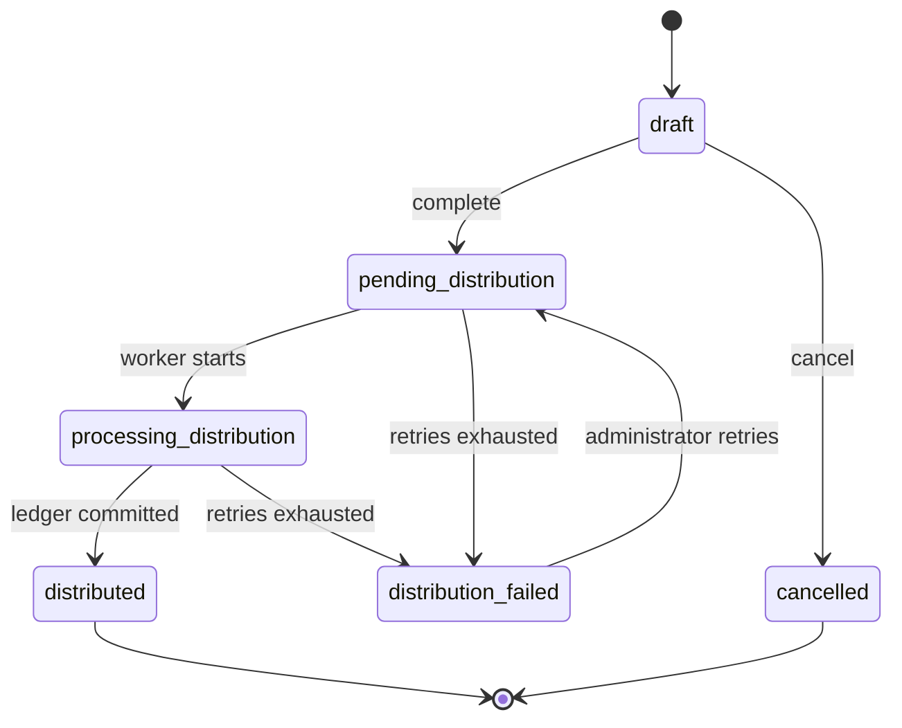
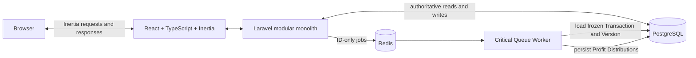

# ProfitFlow

**Dynamic Profit Distribution System**

ProfitFlow is an internal administration application for managing products and
sales transactions, calculating revenue, production cost, and net profit, and
sharing profitable transaction items through configurable, versioned rules.
Rules are specific to a Product Category, distribution runs asynchronously,
and completed financial history retains the exact rule and amounts that were
used.

ProfitFlow is not a public e-commerce application. It has no storefront,
checkout, Customer portal, or Investor portal.

## Business problem

A company sells Products to Customers. Each Transaction produces revenue and
production cost; the difference is net profit. That profit may be shared with
Investors and the company under rules that change over time. ProfitFlow makes
those changes configurable without allowing a new rule to reinterpret an
older completed Transaction.

## Core business concepts

| Concept               | Meaning in ProfitFlow                                                                                                  |
| --------------------- | ---------------------------------------------------------------------------------------------------------------------- |
| Customer              | The party purchasing Products and creating revenue. A Customer is not an Investor.                                     |
| Investor              | An owner or stakeholder profile associated with profit participation. An Investor is not linked to a purchase.         |
| Profit Recipient      | The stable allocation identity used inside a Profit Scheme. It represents either the company or one linked Investor.   |
| Product Category      | The grouping that determines which category-specific rule can apply to an item.                                        |
| Product               | Sellable master data with a Category, SKU, default selling price, and default production cost.                         |
| Profit Scheme         | The named parent for a sequence of rule Versions.                                                                      |
| Profit Scheme Version | A dated, publishable rule revision with one Category, profit range, priority, and exact recipient allocations.         |
| Transaction           | A Customer sale containing one or more item snapshots and an explicit lifecycle status.                                |
| Profit Distribution   | An immutable ledger row recording an item, frozen Version, recipient, percentage, recipient-name snapshot, and amount. |

Investor and Profit Recipient are intentionally separate. The Investor is the
business profile; the Profit Recipient is the identity referenced by
allocations and distribution history. This lets a company allocation exist
without an Investor and prevents routine Investor profile changes from
rewriting financial records.

## Main features

- Product Category, Product, Customer, Investor, and Profit Recipient
  management.
- Category-specific Profit Schemes with editable Draft Versions and immutable
  published Versions.
- Exact allocation validation requiring `100.0000%` before publication.
- Draft Transaction creation and editing with trusted production-cost and
  product/category/price snapshots.
- Per-item Profit Scheme resolution during Transaction completion.
- Redis-backed, queued profit distribution with a focused live status refresh
  on pending and processing Transaction detail pages.
- Safe redrive of Pending Distribution work and retry of Distribution Failed
  work.
- Draft-only Transaction cancellation with retained read-only history.
- Immutable completed item, rule, percentage, recipient-name, and amount
  snapshots.
- A PostgreSQL-backed financial Dashboard with lifecycle attention lists and
  top Profit Recipients.
- Deterministic demonstration data and one verified local administrator.
- Internal routes protected by authentication and verified-email middleware;
  public registration is disabled.

## Core business flow

```mermaid
flowchart LR
    A[Administrator] --> B[Master Data]
    B --> C[Category-specific Profit Scheme and Version]
    C --> D[Draft Transaction]
    D --> E[Complete Transaction]
    E --> F[Resolve each profitable item]
    F --> G[Freeze applied Version]
    G --> H[Pending Distribution]
    H --> I[Redis critical queue]
    I --> J[Queue Worker]
    J --> K[Immutable Profit Distributions]
```



1. The administrator prepares Categories, Products, Customers, Investors,
   Profit Recipients, and published Profit Scheme Versions.
2. A Draft Transaction copies Product identity, Category, selling price, and
   production cost into item snapshots.
3. Completion recalculates every item from those snapshots, resolves a rule
   for each profitable item, and stores the exact applied Version.
4. The Transaction becomes Pending Distribution and an ID-only job is
   dispatched after the database commit.
5. The worker loads the Transaction and its frozen Versions from PostgreSQL.
   It does not resolve the current rule again.
6. Distribution rows and the final Distributed status are committed
   atomically.

## Financial calculations

For each Transaction item:

```text
Revenue = Quantity × Unit Selling Price
Production Cost = Quantity × Unit Production Cost
Net Profit = Revenue - Production Cost
```

For the Transaction:

```text
Total Revenue = Sum of Item Revenue
Total Production Cost = Sum of Item Production Cost
Total Net Profit = Sum of Item Net Profit
```

Money uses `decimal(18, 2)` storage and checked integer minor-unit arithmetic.
Percentages use `decimal(7, 4)` storage and exact four-decimal percentage
units. Browser previews also use string and integer-based arithmetic;
JavaScript binary floating-point arithmetic is not authoritative.

An item with zero or negative net profit creates no Profit Distribution. The
Transaction may still complete, including when every item is non-profitable.
Because rules apply per item, a mixed Transaction can distribute all profit
from its positive items even while another item reduces the Transaction's
overall net profit.

For a positive item, each allocation except the final allocation is rounded to
the nearest cent. Any remaining cents are assigned to the final recipient in
the configured allocation order. The stored allocation total is rechecked
against the full distributable item profit, so rounding never loses or creates
money.

## Profit Scheme resolution and versioning

### Category requirement

Every new or editable Profit Scheme Version requires one normal,
non-deleted Product Category. There is no General or All Categories fallback:
a Transaction item can use only a Version whose Category ID exactly matches
the item's stored Category ID.

The database column remains nullable for compatibility with the established
schema, but application validation rejects a missing Category at creation,
update, and publication, and the resolver never selects a category-null
Version.

### Version selection within one Scheme

For each Profit Scheme and Transaction date, the resolver first selects the
highest published Version number whose effective period includes that date.
Only that current Version is evaluated for:

- active parent Scheme and active Version;
- exact Product Category;
- inclusive minimum and maximum item-profit bounds.

If that current Version is inactive, has a different Category, or is outside
the profit range, the Scheme produces no candidate. An older Version from the
same Scheme is not used as a fallback. Priority does not compare Versions
within one Scheme.

### Selection across different Schemes

When current Versions from multiple Schemes match the same Category and item,
the resolver uses this deterministic order:

1. priority descending;
2. publication time descending;
3. Version number descending;
4. database ID descending.

### Historical integrity

Completion stores the exact applied Version on each profitable Transaction
item before queue dispatch. New Versions do not cause completed items to
re-resolve, and retries use the same frozen Version. Profit Distribution rows
also preserve the applied percentage, amount, and recipient-name snapshot.
Old Versions remain visible for historical review.

For example:

```text
Electronics Growth V1 -> TRX-DEMO-001 on 10 July 2026
Electronics Growth V2 -> TRX-DEMO-002 on 16 July 2026
```

Publishing or using V2 does not move the older Transaction away from V1.

## Transaction lifecycle



| Status                  | Allowed behavior                                                                                                                          |
| ----------------------- | ----------------------------------------------------------------------------------------------------------------------------------------- |
| Draft                   | Editable, completable, and cancellable.                                                                                                   |
| Pending Distribution    | Financial and applied-Version snapshots are final; work is waiting for the critical queue worker.                                         |
| Processing Distribution | A worker is processing the frozen Transaction.                                                                                            |
| Distributed             | Distribution is complete and financial history is read-only.                                                                              |
| Distribution Failed     | Queue processing exhausted its configured attempts. The sale itself remains finalized; an administrator may retry safely.                 |
| Cancelled               | Reachable only from Draft. Items and totals remain readable, but no rule is frozen, no job is dispatched, and no Distribution is created. |

Pending, Processing, Distribution Failed, and Distributed Transactions cannot
be cancelled. Completion and cancellation both lock the Transaction row, so
concurrent attempts serialize and only a valid Draft transition can win.

## Reliability and data integrity

ProfitFlow combines application lifecycle rules with PostgreSQL safeguards:

- PostgreSQL transactions keep aggregate writes atomic.
- Row-level locks serialize completion, cancellation, retry, and distribution.
- Completion dispatches the queue job only after the outer database commit.
- Profit distribution uses the Redis `critical` queue.
- The job has 3 attempts, `10`, `30`, and `60` second backoffs, and a
  120-second timeout.
- Redis `retry_after` is 150 seconds, longer than the job timeout.
- Distribution first records Processing Distribution, then atomically inserts
  all ledger rows and records Distributed.
- Status checks make already Distributed work a no-op.
- The unique `(transaction_item_id, profit_recipient_id)` ledger constraint
  protects against duplicate delivery.
- Existing ledger rows in a non-Distributed state are rejected instead of
  being silently overwritten.
- Restrictive foreign keys, financial snapshots, and read-only lifecycle
  Actions preserve completed history.
- Failed retry and Pending redrive dispatch the same ID-only job and retain the
  frozen Version.

The delivery model is at-least-once-capable with idempotent database
processing. Dispatch after commit prevents a worker from observing
uncommitted data, but a full transactional outbox is not implemented. A
process crash between PostgreSQL commit and successful Redis enqueue can leave
a Transaction pending; the administrator's Pending redrive action is the
current recovery path.

PostgreSQL remains the source of truth. Redis transports job identifiers; it
does not own authoritative financial state.

## Dashboard semantics

The Dashboard deliberately distinguishes finalized business totals from
workflow counts:

- Draft and Cancelled Transactions are excluded from Revenue, Production Cost,
  and Net Profit.
- Pending Distribution, Processing Distribution, Distributed, and
  Distribution Failed Transactions are finalized and included in those
  financial totals.
- Distributed Profit is summed from actual immutable Profit Distribution
  rows, not inferred from configured allocations.
- Total Transaction count and the status summary include all Transaction
  statuses.
- Top Profit Recipients are ranked by actual distributed ledger amounts and
  may include both Investor and Company recipients.
- Recent Transactions are limited to eight; Pending and failed attention lists
  are each limited to five.

The Dashboard has no chart or application-level result cache.

## Architecture



The Browser uses React pages delivered through Inertia, while Laravel owns
validation, authorization boundaries, use-case Actions, domain services, and
queries. The queue worker is another process of the same modular monolith, not
a separate microservice.

## Technology stack

Versions below are from the committed lock files.

| Area             | Technology                                                                                  |
| ---------------- | ------------------------------------------------------------------------------------------- |
| Backend          | PHP `^8.3`; Laravel `13.19.0`; Fortify `1.37.2`; Inertia Laravel `3.1.1`; Predis `3.5.1`    |
| Data and queue   | PostgreSQL `17-alpine`; Redis `7-alpine`; Laravel Queue                                     |
| Frontend         | React `19.2.7`; React DOM `19.2.7`; Inertia React `3.6.1`; TypeScript `5.9.3`               |
| UI and build     | Tailwind CSS `4.3.2`; repository-owned shadcn/ui components; Radix UI; Lucide; Vite `8.1.4` |
| Backend quality  | PHPUnit `12.5.31`; PHPStan `2.2.5` with Larastan `3.10.0`; Pint `1.29.3`                    |
| Frontend quality | ESLint `9.39.4`; Prettier `3.9.4`; TypeScript compiler; Node's built-in test runner         |

## Project structure

```text
app/
├── Actions/                    Use-case orchestration and guarded mutations
├── Jobs/                       Asynchronous distribution boundary
├── Models/                     Relationships, casts, and reusable scopes
├── Queries/Dashboard/          Read-only Dashboard aggregation
└── Services/ProfitSharing/     Exact calculation, resolution, allocation, and distribution

resources/js/                   React/Inertia pages, components, types, and exact previews
database/migrations/            PostgreSQL schema, constraints, and indexes
database/seeders/               Deterministic master data, rules, and transaction scenarios
tests/                          PHPUnit integration/unit tests and frontend formatter tests
```

Controllers remain thin and delegate financial or lifecycle writes to Actions
and services.

## Requirements

- PHP `8.3` or newer and Composer 2.
- PHP PDO support with the PostgreSQL driver (`pdo_pgsql`).
- Node.js `^20.19.0` or `>=22.12.0`, as required by the locked Vite version,
  with npm.
- Docker with Docker Compose v2.
- Ports `5432` and `6379` available for PostgreSQL and Redis.
- Port `8000` for the example Laravel server and Vite's default development
  port `5173`, unless changed locally.

PostgreSQL and Redis run in Docker; PHP, Composer, Node.js, and npm run on the
host in the documented local workflow.

## Installation and local setup

### 1. Clone and install dependencies

```bash
git clone <repository-url> profitflow
cd profitflow

composer install
npm ci
```

Replace `<repository-url>` with the submission repository's clone URL.

### 2. Create the local environment

```bash
cp .env.example .env
php artisan key:generate
```

The supplied database and Redis values already match Docker Compose. When
using Artisan's example port below, set `APP_URL=http://localhost:8000` in
`.env` so generated URLs and passkey origins match the browser origin.

### 3. Start PostgreSQL and Redis

```bash
docker compose up -d postgres redis
docker compose ps
```

The Compose services are named `postgres` and `redis`. On the first PostgreSQL
volume initialization, `docker/postgres/init/01-create-testing-database.sql`
also creates `profitflow_testing` for the integration test suite.

### 4. Migrate and seed

```bash
php artisan migrate --seed
```

For a disposable local database that must be returned to the exact demo
baseline:

```bash
php artisan migrate:fresh --seed
```

**Warning:** `migrate:fresh --seed` drops every table and deletes all existing
data in the selected database. Do not run it against a database you need to
preserve.

### 5. Start the application

Use three terminals:

```bash
# Terminal 1: Laravel
php artisan serve --host=localhost --port=8000
```

```bash
# Terminal 2: Vite
npm run dev
```

```bash
# Terminal 3: ProfitFlow critical queue
php artisan queue:work redis --queue=critical --tries=3 --timeout=120
```

Open [http://localhost:8000](http://localhost:8000).

Laravel also provides a combined development process:

```bash
composer dev
```

That command starts the Laravel server, Vite, the log viewer, and a listener
for the default queue. ProfitFlow distribution jobs are assigned to the
`critical` queue, so the dedicated critical worker command is still required
in another terminal.

## Environment configuration

Relevant values already present in `.env.example`:

| Variable                                                          | Local purpose                                                                |
| ----------------------------------------------------------------- | ---------------------------------------------------------------------------- |
| `APP_NAME=ProfitFlow`                                             | Application and frontend name.                                               |
| `APP_URL`                                                         | Base URL used for generated links and passkey allowed origins.               |
| `DB_CONNECTION=pgsql`                                             | Selects PostgreSQL.                                                          |
| `DB_HOST`, `DB_PORT`, `DB_DATABASE`, `DB_USERNAME`, `DB_PASSWORD` | Match the local `postgres` Compose service and exposed port.                 |
| `SESSION_DRIVER=database`                                         | Stores sessions in PostgreSQL.                                               |
| `CACHE_STORE=database`                                            | Framework cache store; the Dashboard itself does not cache its query result. |
| `QUEUE_CONNECTION=redis`                                          | Sends queued work to Redis.                                                  |
| `QUEUE_AFTER_COMMIT=true`                                         | Defers Redis dispatch until the database commit succeeds.                    |
| `REDIS_QUEUE_RETRY_AFTER=150`                                     | Makes abandoned Redis jobs visible after 150 seconds.                        |
| `REDIS_CLIENT=predis`                                             | Uses the PHP Redis client installed through Composer.                        |
| `REDIS_HOST`, `REDIS_PORT`, `REDIS_PASSWORD`                      | Local Redis connection.                                                      |
| `VITE_APP_NAME`                                                   | Exposes the application name to Vite.                                        |

Do not commit `.env` or real credentials.

## Queue worker

Run the critical worker continuously during the demo:

```bash
php artisan queue:work redis --queue=critical --tries=3 --timeout=120
```

Stop it safely with `Ctrl+C`. To process at most one critical job:

```bash
php artisan queue:work redis --queue=critical --tries=3 --timeout=120 --once
```

Completing a Transaction can leave it at Pending Distribution until this
worker is running. The detail page refreshes its lifecycle data every two
seconds while the status is Pending or Processing, then stops on a terminal
status.

## Demo credentials and deterministic seed

The seeded account is for local demonstration only:

| Field    | Value               |
| -------- | ------------------- |
| Email    | `admin@example.com` |
| Password | `password`          |

The administrator is email-verified. Public registration is disabled, so
additional Users must be provisioned operationally rather than through a
registration page.

The deterministic seed uses a fixed UTC clock and produces:

| Dataset                          | Count |
| -------------------------------- | ----: |
| Product Categories               |     3 |
| Products                         |     6 |
| Customers                        |     4 |
| Investors                        |     3 |
| Profit Recipients                |     4 |
| Category-specific Profit Schemes |     3 |
| Published Profit Scheme Versions |     4 |
| Profit Scheme allocations        |    11 |
| Transactions                     |    12 |
| Transaction items                |    14 |
| Profit Distributions             |    17 |

Transaction statuses:

| Status                  | Count |
| ----------------------- | ----: |
| Draft                   |     2 |
| Pending Distribution    |     1 |
| Processing Distribution |     0 |
| Distributed             |     7 |
| Distribution Failed     |     1 |
| Cancelled               |     1 |

Expected Dashboard values:

| Metric             |         Value |
| ------------------ | ------------: |
| Revenue            | Rp 58.550.000 |
| Production Cost    | Rp 44.350.000 |
| Net Profit         | Rp 14.200.000 |
| Distributed Profit | Rp 13.310.000 |
